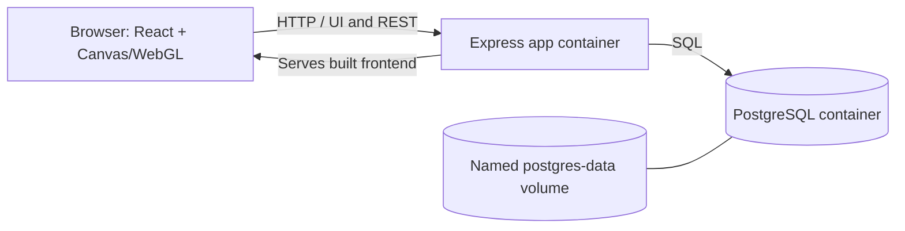

# VISIO — Human Vision Simulator

VISIO is a small educational web application for exploring simplified visual effects associated with minus (myopia), plus (hyperopia), and cylinder (astigmatism) prescription values. It renders a single POV photograph with a matching grayscale depth map in WebGL. It is an educational approximation, not a clinical optical model.

## Problem and motivation

Prescription values are abstract numbers. VISIO provides an interactive way to observe how three common parameters can affect a view, while demonstrating a React frontend, GLSL/WebGL graphics, an Express REST API, PostgreSQL persistence, and Docker deployment in one understandable project.

## Technology and architecture

- React 18 and Vite; responsive CSS.
- HTML Canvas, WebGL, and a separate GLSL fragment shader.
- Node.js 22 and Express 4.
- PostgreSQL 16.
- Docker multi-stage build and Docker Compose.



## Project structure

```text
backend/
  src/app.js                 Express app and static frontend serving
  src/server.js              Startup and database initialization/retry
  src/db.js                  PostgreSQL pool and table schema
  src/routes/simulations.js  Simulation REST routes
  schema.sql                 Reference schema
  test/api.test.js           Health endpoint test
frontend/
  src/App.jsx                Interface and controls
  src/components/            WebGL canvas component
  src/shaders/vision.frag    Fragment shader
  src/style.css              Responsive dark theme
public/assets/README.md      Instructions for the one image/depth pair
Dockerfile                  Frontend builder, backend dependencies, runtime
docker-compose.yml          App, PostgreSQL, optional Adminer, network, volume
```

## Scene assets

The repository does **not** include an RGB photograph or depth map. Add a single suitable POV photograph as `public/assets/scene.jpg`, then generate a grayscale depth map from that exact photograph at `public/assets/scene-depth.png`. The files must have the same pixel dimensions. Do not pair the photo with a depth map generated from another image. See [`public/assets/README.md`](public/assets/README.md). The interface reports missing assets or dimension mismatches; it never substitutes an unrelated scene.

The map's grayscale value is treated as relative depth; this is a deliberately simple approximation. At zero parameters the shader returns the original sharp image.

## Local development

Requirements: Node.js 22 and npm; PostgreSQL is needed for saving/history.

1. Copy `.env.example` to `.env` and set a local `POSTGRES_PASSWORD`.
2. Start PostgreSQL locally, and set `DB_HOST`, `DB_PORT`, and the database/user/password values in `.env` appropriately.
3. Install dependencies: run `npm install` at the repository root, then `npm install --prefix frontend` and `npm install --prefix backend`.
4. Run `npm run dev`. Vite serves the frontend on port 5173 and Express runs on port 3000; Vite proxies `/api` and `/health` to Express.

For the simplest complete setup, use Docker Compose below. To build just the frontend, run `npm run build`.

## Docker setup

1. Copy `.env.example` to `.env` and replace `POSTGRES_PASSWORD` with a private local value. `.env` is ignored by Git and Docker build context.
2. Add the optional scene files described above (they are copied into the application image).
3. Run `docker compose up -d --build`.
4. Open [http://localhost:3000](http://localhost:3000). Check the API at [http://localhost:3000/health](http://localhost:3000/health).
5. To inspect the optional database UI, run `docker compose --profile tools up -d` and open `http://localhost:8080`. Log in using the `.env` database values; server/host is `db`.
6. Stop containers with `docker compose down`. This leaves the named `postgres-data` volume intact. **Do not use `docker compose down -v`** if saved simulations need to persist.

### Explaining the Dockerfile

The first stage (`frontend-builder`) installs the frontend packages and compiles Vite's static production bundle. Dependency manifests are copied before source files so Docker can reuse the dependency-install layer when only code changes. The second stage (`backend-dependencies`) installs only production Express/PostgreSQL dependencies. The final `runtime` stage starts from a clean, pinned Node Alpine image and copies in only backend source, production dependencies, and the built frontend (plus the optional assets directory). `WORKDIR` sets predictable paths, `ENV` sets production mode and the port, `EXPOSE` documents port 3000, and the JSON-array `CMD` launches Node directly without a shell wrapper. This keeps build tooling out of the deployed runtime.

### Explaining Docker Compose

Compose starts two required services. `app` builds the Dockerfile, publishes port 3000, and receives configuration from the ignored `.env` file. `db` uses the pinned PostgreSQL image and the same environment settings. The app connects to host `db` because Compose provides DNS for service names. `depends_on` with `service_healthy` prevents app startup until PostgreSQL passes `pg_isready`; the app also retries its schema connection for resilience. A named `postgres-data` volume stores database files outside the disposable container, so ordinary `docker compose down` does not remove saved records. Both services share the user-defined `visio-network`. Adminer is optional and only starts with the `tools` profile.

## API

### `GET /health`

Returns HTTP 200: `{"status":"ok","service":"visio-api"}`.

```sh
curl http://localhost:3000/health
```

### `GET /api/simulations`

Returns HTTP 200 and up to 50 most recent saved records as a JSON array.

```sh
curl http://localhost:3000/api/simulations
```

### `POST /api/simulations`

Accepts numeric minus `[-10, 0]`, plus `[0, 10]`, and cylinder `[-6, 0]`; minus and plus cannot both be nonzero. Returns HTTP 201 and the inserted record. Invalid values return HTTP 400.

```sh
curl -X POST http://localhost:3000/api/simulations \
  -H 'Content-Type: application/json' \
  -d '{"minus":-2.5,"plus":0,"cylinder":-1.25}'
```

## Database and persistence

The `simulations` table has `id`, `minus`, `plus`, `cylinder`, and `created_at`, with database range checks. On startup the backend creates the table if absent. Compose mounts PostgreSQL's data directory on the named `postgres-data` volume. Container recreation and `docker compose down` retain data; `docker compose down -v` deletes it and should be avoided when persistence matters.

## Testing

Run the backend unit test with `npm install --prefix backend` then `npm test --prefix backend`. With Docker running, check `GET /health`, submit valid and invalid `POST /api/simulations` requests, and reload `GET /api/simulations`. To verify persistence, save a record, run `docker compose down`, start with `docker compose up -d`, and query the history again (without `-v`).

## Screenshots

Add project screenshots here after running with the matching scene assets:

- `docs/screenshots/main-view.png` — main responsive simulator.
- `docs/screenshots/simulation.png` — example parameter configuration.

## AI Usage Declaration

AI assistance was used to draft and refine parts of the application structure, implementation, and documentation. The student should review, test, and be prepared to explain all code, especially the shader approximation, API validation, and Docker configuration, before submission. Asset selection and creation must be performed and verified by the project author; no matching image/depth asset is represented as included here.
